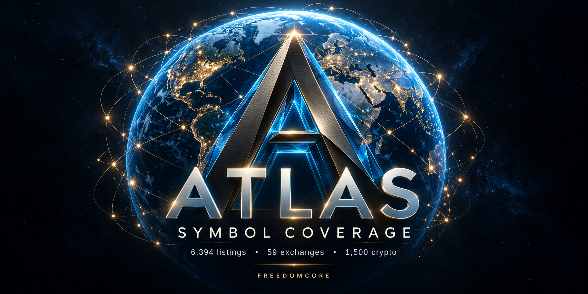

  

# FreedomCore

I'm Rob, and FreedomCore is what I've been building for the past year: AI systems for market research and trading that show their working. I build it with a small team of AI collaborators, Codex, Gemini and Claude, running on my own servers. Changes are checked by one of the others before they go live.

## What I'm building

| Project | What it does | Where |
| :-- | :-- | :-- |
| **Atlas** | My market research desk. 6,394 company and crypto listings across 69 exchanges and venues in 54 countries, each keyed to its exact exchange listing rather than a bare ticker, because the same ticker often means different companies on different exchanges. Coverage is still being filled in: where sources have passed our checks you get dated, source-cited research, and where they haven't yet, the page says so rather than guessing. | [atlas.freedomcore.io](https://atlas.freedomcore.io/) |
| **Maverick** | My KuCoin perpetuals trading system, designed to run three champion strategies in parallel under one shared risk limit. It's being reinstalled after a server move. | [maverick.freedomcore.io](https://maverick.freedomcore.io/) |
| **Shadow** | HyperLiquid copy-trading research, built to profile wallets and filter out scalpers before anything is followed. | [shadow.freedomcore.io](https://shadow.freedomcore.io/) |
| **Arena** | A public leaderboard of the wallets Shadow tracks, ranked on conservative win-rate and quality scores. | [arena.freedomcore.io](https://arena.freedomcore.io/) |
| **Quantum** | AI-built portfolios for crypto founders. It's being reinstalled after a server move and will be back soon. | |

## Open data

I publish Atlas's listing register openly so anyone can check it, cite it or build on it. It refreshes daily, records whether each price is live for its exchange's session, and is free under CC BY 4.0.

- GitHub: [freedomcore-datasets](https://github.com/freedomcoreai-lang/freedomcore-datasets)
- Hugging Face: [freedomcoreai](https://huggingface.co/freedomcoreai), including the [Atlas Symbol Explorer](https://huggingface.co/spaces/freedomcoreai/atlas-symbol-explorer) to search every listing and see which prices are live
- Kaggle: [atlasfreedomcoreio](https://www.kaggle.com/atlasfreedomcoreio)
- On Atlas: [atlas.freedomcore.io/datasets](https://atlas.freedomcore.io/datasets/)

## The standards the trading side is built to

These are the design rules Maverick was built around. They describe how the system is meant to work, not a live performance claim, and while Maverick is being reinstalled nothing is trading.

1. **Honest testing.** Candidate strategies are re-run with a time shift. If a score collapses, the strategy was peeking at the future and is thrown out.
2. **Beat it or hold.** A new strategy only replaces the current one if it beats it on the same fresh week of data. If nothing beats it, nothing changes.
3. **Walk-forward checks.** A survivor has to hold up in every rolling sub-window, not just on average.
4. **A second opinion.** Independent AI reviewers vote on each promotion, and a split vote keeps the incumbent.
5. **Safe switch-overs.** Changes run a health check and roll back automatically if anything fails.

The strategy code itself stays private. What you'll find here is the public data, the sites and the infrastructure.

## Get in touch

For partnerships, licensing or questions about the data: [freedomcoreai@gmail.com](mailto:freedomcoreai@gmail.com)

Everything here is research. None of it is financial advice, and Atlas doesn't execute trades.
